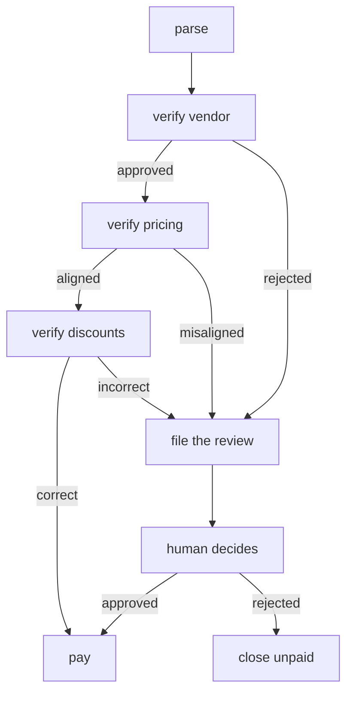

# Relate Flow

Relate Flow is a separate product that embeds Relate. A store holds many
named plans. On each call it tells the agent the single next thing to do in
one of those plans. The
agent performs the work and reports an outcome. Relate Flow admits the report
or refuses it.

The binary is `relate-flow`.

Relate Flow is not a runtime. It does not run steps, call tools, or decide
whether a piece of work was done well. It decides which step may be performed,
by whom, and what a report is allowed to say.

## Goals

- An agent builds a plan one step at a time and receives one instruction: do
  this step, wait, stop, or revise the plan.
- A report that breaks the plan is refused, and the refusal says how to fix it.
- The plan survives the process. The store is a Relate database.
- A branch is taken because a recorded result matched a token in the plan, not
  because the agent chose the next step.
- More than one actor can share a plan. Each actor is told only the step that
  belongs to it.
- A revision keeps work that already succeeded.

## Non-goals

- Executing the work inside a step.
- Judging the text of a `doneWhen` condition. The agent's note is the evidence.
- A workflow language: timers, signals, compensation, or sub-plans.
- Several lineages under one name. A name is one committed plan and its draft.
- Agents writing Cypher to move a step along. Cypher is not the agent API.
- Shipping inside the Relate engine, or as a Relate extension. An extension is
  a child process speaking to a host that owns the store. Flow owns the store
  and the transition rules.
- A plan file for the agent to author. The agent builds the plan with flags and
  reads it back with `show`.
- A long-running service, a REPL, a daemon, hooks, or a heartbeat endpoint.

## Shape

Two pieces live in this repository.

- A library opens a `relate::Database` and implements the verbs below. It is
  the only writer. Every rule in this document is a library rule.
- `relate-flow` is a stateless CLI over that library. One invocation opens the
  store, performs one admission, prints one JSON object, and exits.

Durability, crash recovery, and concurrent writers are Relate's. Flow does not
keep a second log. A claim is one transaction. Two claims that touch the same
step conflict, and the loser is told to call `next` again. Two claims that
touch different steps both succeed.

The default store is `./.relate-flow`, a Relate directory. `:memory:` is
accepted for tests. `goal` creates a store that does not exist yet.

## Templates and executions

`goal`, `add`, and `commit` build a template. The template's steps stay
pending. `execute NAME` copies the committed template into a new plan called
`NAME`, with its own steps and attempts. `next` and `report` run only on that
copy. `next` on a template returns `not_a_run`.

`--input KEY=VALUE` repeats. Those pairs are stored on the execution and
appear in `inputs` on every `run`, including the first step. A key that is
already a produce is `input_conflicts`. A name that already exists is
`name_taken`. `execute` on an execution is `not_a_template`.

`revise` and `commit` on an execution change that run. A later commit of the
template is what the next `execute` copies. Runs already copied keep the
template version they started from. `show`, `status`, `explain`, and `log`
still open a template.

## The instruction

`next` prints one object. The agent switches on `action`. `run`, `waiting`,
`blocked`, `replan`, and `done` all exit 0. They are answers.

| `action` | Meaning |
| --- | --- |
| `run` | This agent holds the lease on one step and should perform it. |
| `waiting` | Work is ready or running, and none of it belongs to this agent. |
| `blocked` | A step is blocked, and nothing is ready or running for anyone. |
| `replan` | A step has used its failed attempts, or no remaining step can become ready. |
| `done` | Every step has succeeded or been skipped. |

`next` decides in this order:

1. This agent holds a live lease. Return that step with `"renewed": true` and
   extend the lease. Do not hand the same agent a second step.
2. A ready step is claimable by this agent. Lease the earliest one in document
   order.
3. A step is ready or running for some other actor. Return `waiting`.
4. A step has used its failure budget. Return `replan`.
5. A step is blocked. Return `blocked`.
6. No step can become ready. Return `replan`.
7. Every step is succeeded or skipped. Return `done`.

A `run` object carries the step the agent needs and nothing else:

```json
{
  "action": "run",
  "step": {
    "id": "verify-discounts",
    "attempt": "a4",
    "title": "Check the volume discount on INV-1042",
    "doneWhen": "The 10% discount is confirmed, or the shortfall is recorded",
    "needs": ["parse", "verify-pricing"],
    "produces": "discounts",
    "results": ["correct", "incorrect"],
    "inputs": {
      "invoice": "Northwind, INV-1042, 100 widgets at $100, no discount stated, billed $10,000.",
      "pricing": "100 widgets at $100 matches NW-2024."
    },
    "leaseUntil": "2026-11-10T22:15:00Z"
  }
}
```

`inputs` is keyed by produce name. It starts with the pairs bound by
`execute`, then the note from each step this step `needs`, and from each step
named by its `when` or `whenAny`, when that step succeeded. A skipped producer
is omitted. Notes are written for this reader. Flow does not copy the whole
plan into the instruction.

When the attempt is a retry, the step also carries `"retry": N`, the number of
failed attempts already recorded.

The other instructions:

```json
{ "action": "waiting", "for": "human", "step": "human-review", "because": "Agreed total $9,000, billed $10,000." }
```

```json
{ "action": "blocked", "step": "verify-pricing", "because": "NW-2024 is not in the store." }
```

```json
{ "action": "replan", "step": "parse", "because": "failed 2 times" }
```

```json
{ "action": "done", "version": 1 }
```

On `waiting`, `because` is the note of the result that opened the branch. Flow
walks from the waited step back through `needs` until it finds a step admitted
by a matching `when` or `whenAny`, and uses that attempt's note. On `blocked`,
`because` is the text the agent reported. On `replan` after a budget is used,
`because` is `failed N times`. On `replan` because nothing can become ready,
the step is omitted and `because` is `no step can become ready`.

`next --output text` prints the same instruction as plain text. JSON stays the
default. A refusal is still one JSON error object. A `run` names the step, its
`doneWhen`, and the bound inputs, then the two reports this agent can make:
`succeeded` with `--note` (and `--result <tok1|tok2>` when the step declares
results) and `failed` with `--because`. `Renewed.` and `Retry N.` follow the
lease line when they apply. `waiting`, `blocked`, `replan`, and `done` are
one line and include no report command.

## Building a plan

The agent builds the plan with flags. It never writes a plan document. Each
call adds or changes one thing, and a refusal names that call. The plan is
checked as a whole only at `commit`.

A draft is the plan being edited. `next` and `report` are refused while a
draft is open. The fix is `commit` or `abort`. `status`, `show`, `explain`,
and `log` still work. `show` prints the draft when one is open, otherwise the
committed plan, so the agent can read back what it built.

```bash
relate-flow goal --text "Pay INV-1042, or hand it to a person"
relate-flow add parse \
  --title "Parse INV-1042" \
  --done-when "Vendor, lines, stated discounts, and the billed total are recorded" \
  --produces invoice \
  --actor invoices
relate-flow add verify-vendor \
  --needs parse \
  --title "Verify Northwind is approved to bill" \
  --done-when "Northwind is approved, or the reason it is not is recorded" \
  --produces vendor \
  --results approved --results rejected \
  --actor invoices
relate-flow commit
```

`goal` creates the store and an empty draft. `--text` is required then.
`--retries N` sets the failure budget and defaults to 2. A later `goal` on the
same draft updates the text, the retries, or both. At least one of the two
flags is required. Called against a committed plan with no draft, it is
refused. The fix is `revise`.

`revise` copies the committed plan into a new draft, in the same step order. It is refused when a
draft is already open, or when no plan is committed. `abort` deletes the draft
and leaves the committed plan. Aborting when no draft exists exits 0.

`add`, `set`, and `drop` require an open draft. With a committed plan and no
draft, the fix is `revise`. With neither, the fix is `goal`.

`add ID` appends a step. Document order is add order, and that is the order
`next` uses when more than one step is ready. `--before ID` or `--after ID`
places it elsewhere. The two flags cannot be combined.

| Flag | Field | Rule |
| --- | --- | --- |
| `ID` | `id` | Required positional. Unique in the draft. A slug: a lowercase letter, then lowercase letters, digits, and hyphens. |
| `--title` | `title` | Required on `add`. Non-empty. |
| `--done-when` | `doneWhen` | Required on `add`. Non-empty. Shown to the agent. Not evaluated. |
| `--produces` | `produces` | Optional. Unique in the draft when present. The name a condition uses. |
| `--results` | `results` | Repeatable. Distinct slugs. A step with results must `--produces`. |
| `--needs` | `needs` | Repeatable step id. The step does not have to exist yet. |
| `--when PRODUCE=TOKEN` | `when` | Repeatable. All of the pairs must match. |
| `--when-any PRODUCE=TOKEN` | `whenAny` | Repeatable. Each flag is one alternative, and any alternative matching admits the step. Commas inside one flag AND those pairs: `--when-any discounts=correct,vendor=approved`. |
| `--actor` | `actor` | Optional slug. Only this agent may be leased the step. Omitted means any agent. |

`--when` and `--when-any` cannot appear on the same command. A condition is
`produce=token` and nothing else. Both sides are slugs. Anything else is a
usage error. A token that is not in the producer's results, or a produce name
no step has, is allowed while drafting and refused at `commit`, because the
producer may be added later.

`set ID` changes only the flags it is given. A repeated flag replaces that
whole list: passing `--needs` once replaces every need. `--no-actor`,
`--no-produces`, `--no-needs`, `--no-results`, and `--no-when` clear those
fields. `--no-when` clears both `when` and `whenAny`. A `--no-*` flag together
with the flag it clears is a usage error. `--before` and `--after` move the
step. `set` refuses a step that would keep results and lose `produces`.

`drop ID` removes a step from the draft. It is refused when another step needs
it or names its produce in a condition. The fix lists those steps. It is also
refused when that id succeeded on the committed plan. Completed work cannot be
dropped.

Repeating a call that already has the same effect exits 0 and changes nothing.
`add` of an id that exists with different flags is refused. The fix is `set`.

`commit` checks the draft, and on success writes the next version and deletes
the draft. It does not lease a step. The checks are the ones that need the
whole plan:

- The draft has a goal and at least one step.
- Every `needs` id exists.
- Every produce name in a condition is some step's `produces`, and every token
  is in that step's `results`.
- A step has at most one of `when` and `whenAny`.
- `needs` edges and the producer references inside conditions form an acyclic
  graph.

`retries` is the number of failed attempts a step may record. After that many
failures the step stays `failed` and is not leased again, and `next` returns
`replan`.

`needs` is the strong edge. A step is skipped when something it needs is
skipped, and it cannot run until everything it needs has succeeded. A step
that must still run after some other branch was skipped must not need a step
that branch skips. Put the condition in `--when` or `--when-any` instead.

`commit --dry-run` prints the result with `"dryRun": true` and leaves the
draft in place. `commit` with no draft is refused.

`show` prints the open draft, or the committed plan when there is no draft:

```json
{
  "draft": true,
  "basedOn": null,
  "goal": "Pay INV-1042, or hand it to a person",
  "retries": 2,
  "steps": [
    {
      "id": "parse",
      "title": "Parse INV-1042",
      "doneWhen": "Vendor, lines, stated discounts, and the billed total are recorded",
      "produces": "invoice",
      "actor": "invoices"
    }
  ]
}
```

`basedOn` is the committed version a revision started from, and `null` for the
first draft. This object is output. The agent reads it. It is not a document
the agent writes back.

Each building command prints one object. `add` prints `{"draft": true, "step":
"parse", "steps": ["parse"]}`. `goal` prints the text and the retries. `drop`
prints the remaining ids. `abort` prints `{"aborted": true}`, or
`{"aborted": false}` when there was nothing to abort.

## Admission

A produce token is resolved as follows.

- The producer has not succeeded and is not skipped. The token is unresolved.
- The producer succeeded with that result. The token matches or it does not.
- The producer was skipped. The token is resolved and unmatched.

Dispositions are computed in dependency order.

| Disposition | When |
| --- | --- |
| skipped | Any step it needs is skipped, or its `when` / `whenAny` is fully resolved and does not match. |
| ready | Every step it needs has succeeded, and it has no `when`, or its `when` matches, or one `whenAny` map matches. |
| pending | Otherwise. |

A `whenAny` stays unresolved while any token it names is still unresolved, so
a later failure can still admit it. It is skipped only once every alternative
is resolved and none match. One recorded match is enough to make the step
ready, even if other alternatives are unresolved or unmatched.

Only a ready step whose `actor` is omitted or equals the caller is claimable.

Skipped does not satisfy `needs`. Only succeeded does. Dependents of a blocked
or failed step stay pending.

Stored step states are `pending`, `running`, `succeeded`, `failed`, `blocked`,
and `skipped`. Ready is computed, not stored. A failure that still has budget
returns the step to `pending`, and the failed attempt stays in the log. A
failure that has used the budget stays `failed`.

After every admitted report the library recomputes dispositions and writes
them. The agent never writes a state.

## Leases

`next` leases a claimable step to the caller. The default lease is 15 minutes.
`next --lease` overrides it. The maximum is 24 hours. `leaseUntil` is RFC3339
UTC.

The same agent calling `next` again renews its own lease from now and receives
the same step. A lease that has expired is reclaimable. The library closes
that attempt with outcome `expired` and returns the step to `pending`.
`expired` does not count as a failure. There is no heartbeat. Expiry is
checked when `next` or `report` runs.

`report` on a step this agent does not hold, or on a lease that has expired,
is refused. The fix tells the agent to call `next`.

## Reports

```bash
relate-flow report verify-discounts --outcome succeeded --result incorrect \
  --note "Agreed total $9,000, billed $10,000, shortfall $1,000."
```

The step id selects the caller's open lease. The agent does not pass the
attempt id.

| Outcome | Requires | Effect |
| --- | --- | --- |
| `succeeded` | `--note`, non-empty. `--result` when the step declares `results`, and it must be one of those tokens. | The step succeeds. The token is recorded. Dispositions are recomputed. |
| `failed` | `--because`, non-empty. | A failed attempt is recorded. Under budget, the step returns to `pending`. At budget, it stays `failed`. |
| `blocked` | `--because`, non-empty. | The step is blocked. It is not retried. |
| `released` | Nothing. | The lease closes. The step returns to `pending`. The failure count is unchanged. |

`--note` and `--because` are stored verbatim. Flow does not decide whether the
note satisfies `doneWhen`.

`--artifact PATH` may be added to any outcome. Flow stores the path and the
SHA-256 of the file. It does not copy the file. An unreadable path refuses the
report and writes nothing.

Repeating the same outcome for the same attempt, with the same result and
text, prints the original result and exits 0. The same attempt with a
different outcome exits as a conflict and changes nothing.

A successful report prints the recorded attempt:

```json
{ "step": "verify-discounts", "attempt": "a4", "outcome": "succeeded", "result": "incorrect" }
```

The agent then calls `next` for the following instruction. `report` does not
lease the next step.

## Revisions

`revise` followed by `commit` appends a version. It does not edit the previous
one. The new version `SUPERSEDES` the old. Until `commit`, only the draft
changes.

| Previous step | In the draft | Result |
| --- | --- | --- |
| Succeeded, same id, same `doneWhen` | present | The success and its attempts are kept. |
| Succeeded, same id, `doneWhen` changed | present | The step reopens. Old attempts stay on the old version. The success does not carry. |
| Succeeded | absent | Refused at `drop` and again at `commit`. Completed work cannot be dropped. |
| Anything else, same id | present | Reopened at `pending`, including a step that is blocked, failed, or leased. A live lease is cancelled. |
| Anything else | absent | Dropped. |

`revise` then `commit`, with no edits in between, is how a person clears a
block. The blocked step reopens, and succeeded steps stay succeeded.
Dispositions are recomputed, so a step whose condition no longer matches
becomes skipped.

`set` of `--done-when` on a step that succeeded includes `"reopens": true` in
its result, so the agent sees that before `commit`.

`commit` prints what changed and does not lease anything:

```json
{
  "version": 2,
  "kept": ["parse", "verify-vendor"],
  "reopened": ["verify-pricing"],
  "added": [],
  "removed": [],
  "frontier": ["verify-pricing"]
}
```

`frontier` is the ready steps in document order, ignoring `actor`.

## CLI

```text
relate-flow PLAN goal --text TEXT [--retries N] [-d PATH]
relate-flow PLAN add ID --title TEXT --done-when TEXT [--produces NAME] [--needs ID]... [--results TOKEN]... [--when PRODUCE=TOKEN]... [--when-any PRODUCE=TOKEN]... [--actor NAME] [--before ID | --after ID] [-d PATH]
relate-flow PLAN set ID [--title TEXT] [--done-when TEXT] [--produces NAME | --no-produces] [--needs ID]... [--no-needs] [--results TOKEN]... [--no-results] [--when PRODUCE=TOKEN]... [--when-any PRODUCE=TOKEN]... [--no-when] [--actor NAME | --no-actor] [--before ID | --after ID] [-d PATH]
relate-flow PLAN drop ID [-d PATH]
relate-flow PLAN commit [--dry-run] [-d PATH]
relate-flow PLAN execute NAME [--input KEY=VALUE]... [-d PATH]
relate-flow PLAN remove [--force] [-d PATH]
relate-flow PLAN prune [-d PATH]
relate-flow PLAN revise [-d PATH]
relate-flow PLAN abort [-d PATH]
relate-flow PLAN show [--output json|text] [-d PATH]
relate-flow PLAN next [--agent NAME] [--lease DURATION] [--output json|text] [-d PATH]
relate-flow PLAN report STEP --outcome OUTCOME [--result TOKEN] [--note TEXT] [--because TEXT] [--artifact PATH] [--agent NAME] [-d PATH]
relate-flow PLAN status [-d PATH] [--json]
relate-flow PLAN explain STEP [-d PATH]
relate-flow PLAN log [STEP] [-d PATH] [--json]
```

The first argument is the plan name, a slug. `relate-flow --help` lists the
plans in the store and the `-d` / `--database` flag. `relate-flow -d PATH`
lists the plans in that store. `skill` is not a plan name. `-d` / `--database`
selects the store and may come before the plan or after the command.
`RELATE_FLOW_DATABASE` is the same value. The flag wins. The default is
`./.relate-flow`.

`--agent` names the caller. `RELATE_FLOW_AGENT` is the same value. The flag
wins. `next` and `report` require it.

`goal`, `add`, `set`, `drop`, `commit`, `revise`, `abort`,
`report`, and `explain` always print one compact JSON object on a single line.
`show` does too, unless `--output text`, which draws the flow as boxes and
arrows. `next` does too, unless `--output text`, which prints the instruction
as a prompt. `json` is the default. A refusal from either command stays JSON.
`status` and `log` print a table when stdout is a terminal and the same JSON
when it is not. `--json` forces JSON for those two. Errors are JSON on stdout
on every path, including usage errors. While a draft is open, `status` and
`show` describe the draft and include `"draft": true`.

`status` lists every step in document order with its derived disposition, and
its actor and result when it has them. `explain` returns one step: disposition,
why, needs, when, the last attempt, and which tokens or needs are still
missing. `log` returns attempts, newest first, up to 50. `log STEP` limits
that to one step.

`explain` states `why` from the disposition, not from generated prose:

| Situation | `why` |
| --- | --- |
| ready | `ready` |
| running | `leased to <agent> until <leaseUntil>` |
| succeeded | `succeeded` |
| skipped because a need was skipped | `skipped because <step> was skipped` |
| skipped because a condition failed | `skipped because <produce> is <token>` |
| pending on a need | `waiting on <step>` |
| pending on an unresolved token | `waiting on <produce>` |
| blocked | `blocked: <because>` |
| failed, budget used | `failed <n> of <retries>: <because>` |
| pending again after a failure | `ready, failed <n> of <retries>` |

## Exit codes and errors

Stdout is one JSON object on every path. The exit code is how a harness
branches. The `fix` field is what the agent does.

| Exit | Meaning |
| --- | --- |
| 0 | An instruction or a successful write, including `done`, `waiting`, `blocked`, and `replan`. |
| 2 | Usage. Unknown verb, missing flag, `--when` together with `--when-any`, `--before` together with `--after`. |
| 4 | Refusal. Invalid plan, illegal outcome, missing note or result, report on a step this agent does not hold. |
| 5 | Conflict. The lease is held by someone else, or this attempt was already closed with a different outcome. |
| 1 | The store could not be opened or written. |

```json
{
  "error": {
    "code": "not_leased",
    "message": "pay is not the step invoices holds",
    "fix": "report verify-discounts, which is leased until 2026-11-10T22:15:00Z",
    "retryable": false
  }
}
```

Every error has `code`, `message`, `fix`, and `retryable`. A plan with several
problems keeps that shape, puts the first problem's `fix` in `fix`, and lists
every problem in `errors`. Each entry has `code`, `message`, `fix`, and `step`
when the problem is about one step. A client that only reads `fix` can repair
one problem per attempt. A client that reads `errors` can repair them
together.

A conflict sets `retryable` to true when the caller should call `next` again,
and false when the attempt was closed with a different outcome.

## What is stored

The library writes a labeled property graph in the Relate database. Labels and
relationships:

| What | Holds |
| --- | --- |
| `Plan` | `version`, `goal`, `retries`, `createdAt`. A draft has no version. Version 1 has no predecessor. |
| `Step` | The document fields, plus the stored state. `id` is the agent's slug. |
| `Attempt` | `id` (`a1`, `a2`, …), `agent`, `outcome`, `result`, `note`, `because`, `artifact`, `artifactHash`, `leaseUntil`, `startedAt`, `finishedAt`. |
| `HAS_STEP` | `Plan` to `Step`. |
| `SUPERSEDES` | The new `Plan` to the previous `Plan`. |
| `NEEDS` | `Step` to the step it needs. |
| `OF` | `Attempt` to its `Step`. |

`when` and `whenAny` are properties of the step. A draft is a `Plan` with no
version, and its steps are separate nodes from the committed plan. `commit`
writes the next version from the draft, then deletes the draft. `abort`
deletes the draft and does not touch the committed plan. Attempts are
immutable. A new outcome is a new attempt, or a refusal. The library
recomputes step state after each admission so a stored state cannot drift
from the rules.

The plan graph is the whole content of the store. A store that already has
nodes and has no `Plan` is refused. Flow does not write into a database that
already holds someone else's graph.

## Worked example

One invoice is one store. The agent `invoices` drives it. The standing plan
for "pay this invoice, or hand it to a person" is filled in with the invoice's
facts and submitted once. The agent does not invent the branch on the day.

INV-1042 is from Northwind under agreement NW-2024: widgets at $100, with 10%
off a widget line over $5,000. The invoice is 100 widgets. The agreed total is
$9,000. This copy bills $10,000.

```bash
export RELATE_FLOW_DATABASE=./invoices/INV-1042
export RELATE_FLOW_AGENT=invoices
```



`pay` needs only `parse`. It is admitted by `discounts = correct` or
`decision = approved`. It does not need the check steps, because a rejected
vendor skips those steps and a later approval must still be able to pay.
`escalate` needs only `parse` for the same reason. `human-review` needs
`escalate`, so a correct invoice skips the review. `close-rejected` needs
`human-review` and `decision = rejected`.

Every step except `human-review` is added with `--actor invoices`, so a person
calling `next` during the checks is told to wait. `human-review` is added with
`--actor human`. The steps are `parse`; `verify-vendor` (`results`
`approved` | `rejected`); `verify-pricing` (`when` vendor is `approved`,
`results` `aligned` | `misaligned`); `verify-discounts` (needs `parse` and
`verify-pricing`, `when` pricing is `aligned`, `results` `correct` |
`incorrect`); `escalate` (`whenAny` vendor `rejected`, pricing `misaligned`,
or discounts `incorrect`); `human-review` (`results` `approved` | `rejected`);
`pay` (`whenAny` discounts `correct` or decision `approved`); and
`close-rejected` (`when` decision is `rejected`).

The agent builds that plan with one command per step, then commits it. Version
1's frontier is `parse`. `escalate` is pending, not ready: its `whenAny` has
no recorded token yet.

```bash
relate-flow goal --text "Pay INV-1042, or hand it to a person"

relate-flow add parse \
  --title "Parse INV-1042" \
  --done-when "Vendor, lines, stated discounts, and the billed total are recorded" \
  --produces invoice --actor invoices

relate-flow add verify-vendor \
  --title "Verify Northwind is approved to bill" \
  --done-when "Northwind is approved, or the reason it is not is recorded" \
  --needs parse --produces vendor \
  --results approved --results rejected --actor invoices

relate-flow add verify-pricing \
  --title "Match each line to NW-2024" \
  --done-when "Every line matches an agreement price, or each miss is recorded" \
  --needs verify-vendor --when vendor=approved --produces pricing \
  --results aligned --results misaligned --actor invoices

relate-flow add verify-discounts \
  --title "Check the volume discount on INV-1042" \
  --done-when "The 10% discount is confirmed, or the shortfall is recorded" \
  --needs parse --needs verify-pricing --when pricing=aligned \
  --produces discounts --results correct --results incorrect --actor invoices

relate-flow add escalate \
  --title "Open a human review for INV-1042" \
  --done-when "A review is open and holds the invoice, NW-2024, and the mismatch" \
  --needs parse \
  --when-any vendor=rejected --when-any pricing=misaligned \
  --when-any discounts=incorrect \
  --produces review --actor invoices

relate-flow add human-review \
  --title "Decide whether INV-1042 may be paid" \
  --done-when "A person approves a payment amount or rejects the invoice" \
  --needs escalate --produces decision \
  --results approved --results rejected --actor human

relate-flow add pay \
  --title "Pay the agreed amount for INV-1042" \
  --done-when "Payment is submitted for the amount in the inputs and the reference is recorded" \
  --needs parse \
  --when-any discounts=correct --when-any decision=approved \
  --produces payment --actor invoices

relate-flow add close-rejected \
  --title "Close INV-1042 unpaid" \
  --done-when "The invoice is closed with the rejection reason" \
  --needs human-review --when decision=rejected \
  --produces closure --actor invoices

relate-flow commit
```

### The discount is missing

`next` leases `parse`. The agent reads the invoice and reports.

```bash
relate-flow report parse --outcome succeeded \
  --note "Northwind, INV-1042, 100 widgets at $100, no discount stated, billed $10,000."
```

`verify-vendor` is reported `succeeded` with `--result approved`.
`verify-pricing` is reported `succeeded` with `--result aligned` and a note
that 100 widgets at $100 matches NW-2024.

`next` then leases `verify-discounts`. Its `inputs` are the invoice note and
the pricing note. The agent compares $10,000 with the agreement and finds a
$1,000 shortfall.

A report against `pay` at this moment is refused. The leased step is
`verify-discounts`:

```json
{
  "error": {
    "code": "not_leased",
    "message": "pay is not the step invoices holds",
    "fix": "report verify-discounts, which is leased until 2026-11-10T22:15:00Z",
    "retryable": false
  }
}
```

The report that matches the lease:

```bash
relate-flow report verify-discounts --outcome succeeded --result incorrect \
  --note "NW-2024 gives 10% off this line. Agreed total $9,000, billed $10,000, shortfall $1,000."
```

The following `next` leases `escalate`. `pay` stays pending, because
`decision` is unresolved. The agent opens the review and reports that, with
the review id in the note.

`next`, still as `invoices`, now returns `waiting` for `human` on
`human-review`. The `because` is the shortfall note. The invoice agent stops.

A person runs `relate-flow next` with `--agent human` and is leased
`human-review`. The inputs carry the shortfall. They approve the agreement
amount:

```bash
relate-flow report human-review --outcome succeeded --result approved \
  --note "Pay $9,000. Do not pay the billed $10,000." --agent human
```

The next `next` from `invoices` leases `pay`. The inputs include the shortfall
and the approval. The agent submits the payment:

```bash
relate-flow report pay --outcome succeeded --note "Paid $9,000 as PAY-8891."
```

`close-rejected` is skipped because `decision` is `approved`. `next` returns
`done`.

If the person reports `--result rejected`, `pay` is skipped and `next` leases
`close-rejected` to `invoices`.

If `verify-vendor` is reported `rejected`, `next` leases `escalate`, and
pricing and discounts are skipped. An approval still admits `pay`, because
`pay` does not need those skipped steps. A rejection admits `close-rejected`.

### The discount is already correct

The run is the same through `verify-pricing`. The invoice bills $9,000, and
`verify-discounts` is reported `succeeded` with `--result correct`.

`escalate` is skipped, because every token it lists is recorded and none
match. `human-review` and `close-rejected` are skipped because they need
`escalate`. `pay` is ready because `discounts` is `correct`. `next` leases
`pay`. After the payment is reported, `next` returns `done`.

### A missing agreement

If the agent cannot find NW-2024, it reports `verify-pricing` as `blocked`
with a `because`. Nothing else is ready. `next` returns `blocked`. The plan
stays there. `revise` and then `commit`, with no edits, reopens the blocked
step and keeps the steps that succeeded.

## First version

The first version is the library, the building commands, `next` and `report`,
the admission rules, leases, revisions, and the invoice-shaped plan above.

It does not add a way to execute a step, a second output mode for `next`, a
heartbeat, hierarchical plans, or a Cypher surface for agents.

## Skill

`relate-flow skill install` writes an agent skill that ships inside the
binary. The skill teaches the agent to design a plan from the task in front
of it, then drive that plan with `next` and `report`. It does not teach the
agent to change this repository. That contract is `AGENTS.md`.

The skill is a verb on the CLI. It never opens a store. It still prints one
JSON object and uses the same exit codes. Install, remove, list, and check
are specified in `docs/cli.md` and recorded in ADR 0012.
