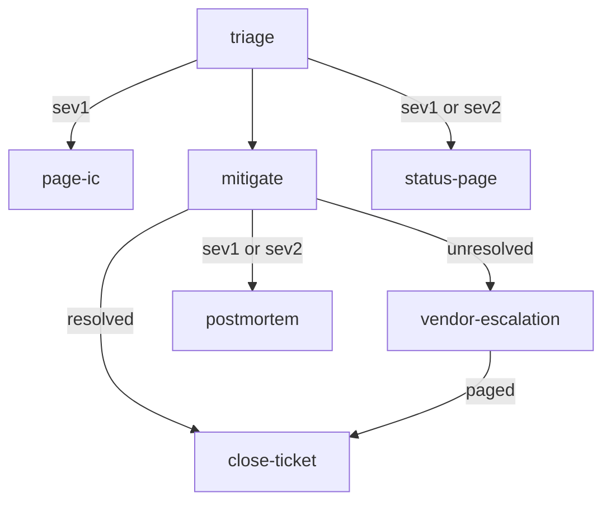

# Incident response

Goal: restore the service, or escalate it. Actors are `oncall`, `ic`, and `comms`. The scripts commit that shape as a template, then `execute` a case named `case` with `--input case=...` before the first `next`.

`page-ic` runs only for `sev1`. `status-page` and `postmortem` run for `sev1` or `sev2`, so a `sev3` skips the page, the notice, and the postmortem. `close-ticket` has no hard need on `mitigate`. It waits until `mitigation=resolved` or `vendor=paged`. A resolved mitigation skips the vendor step and still admits the close.

`status-page` is `comms` and can be ready while `oncall` holds `mitigate`. `next` as `oncall` returns `waiting` for `comms` once mitigation is done and the notice is still open, or it leases `postmortem` when that step is earlier in the claim order for `oncall`. The example scripts ask `comms` before the postmortem.

One failed `mitigate` returns the step to pending with `retry: 1`. A second failure returns `replan`. `revise` and `commit` reopen `mitigate` and keep `triage`.
