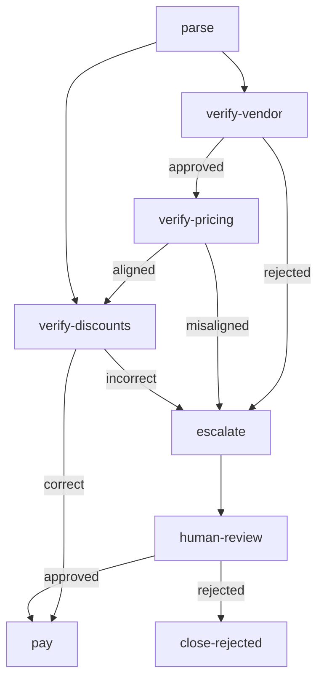

# Invoice

Goal: pay INV-1042, or hand it to a person. The commands are `examples/invoice/plan.sh`. Each run script executes a case before `next`, so the template can be used again.

`pay` needs only `parse`, and is admitted by `discounts=correct` or `decision=approved`. A skipped pricing check does not block payment after a person approves.

## Discount missing, then approved

`verify-discounts` is reported `incorrect` with the shortfall note. `next` as `invoices` then returns `waiting` for `human`, and `because` is that note. The human instruction's inputs include `discounts` (the shortfall) and `review` (the escalate note). After `approved`, `pay` runs and `close-rejected` is skipped.

## Discount missing, then rejected

The same path through escalate. `human-review` is `rejected`. `pay` is skipped and `close-rejected` runs.

## Discount already correct

`verify-discounts` is `correct`. `escalate`, `human-review`, and `close-rejected` are skipped. `next` leases `pay`.

## Vendor rejected

`verify-vendor` is `rejected`. Pricing and discounts are skipped. `escalate` runs. An approval still admits `pay`, because `pay` does not need the skipped steps.

## Missing agreement

`verify-pricing` is reported `blocked`. Nothing else is ready, so `next` returns `blocked`. `revise`, `set verify-pricing --done-when …`, and `commit` reopen that step and keep `parse` and `verify-vendor`. The run then finishes through `pay`.
