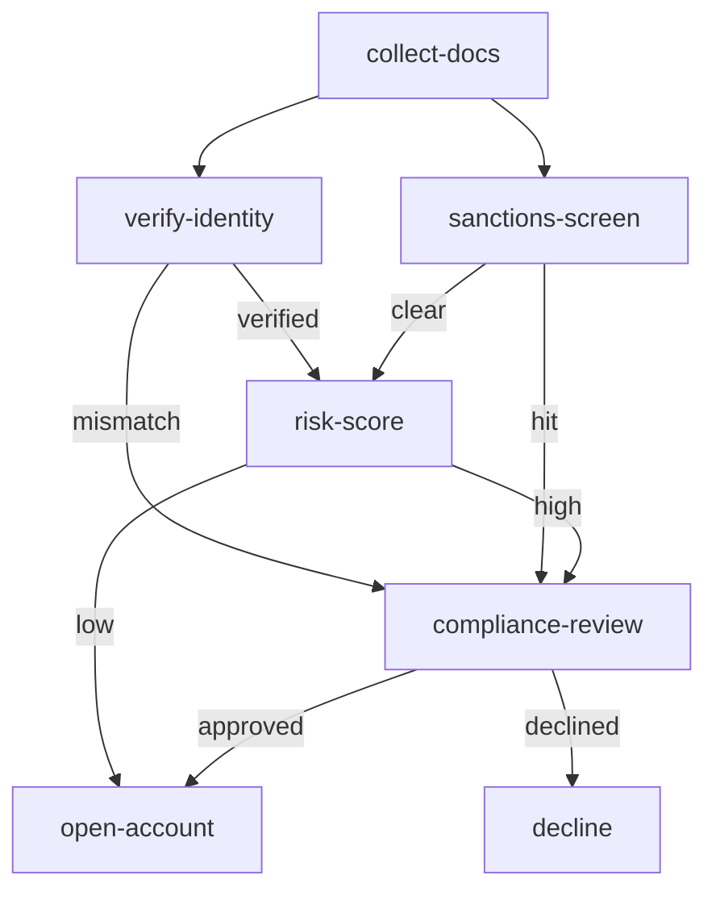

# Customer onboarding

Goal: open the account, or decline the application. Actors are `intake`, `kyc`, `screening`, and `compliance`. Each run script executes a case before `next`. A `revise` in a script edits that case.

`verify-identity` and `sanctions-screen` are both ready after `collect-docs`. Two agents claim one each. `risk-score` runs only when identity is `verified` and sanctions are `clear`. `compliance-review` runs on a mismatch, a hit, or high risk. `open-account` runs on low risk or an approval. `decline` runs only on `ruling=declined`.

A clear file skips compliance and decline. A mismatch skips the risk score, and an approval still opens the account. A sanctions hit that is declined skips the risk score and the account opening.

An unreadable document is `blocked` on `verify-identity`. The sanctions check can still finish. Once nothing else is ready, `next` returns `blocked`. `revise` and `commit` reopen the blocked step and keep the documents and the screening result.

Changing `doneWhen` on a succeeded `collect-docs` makes `set` return `reopens: true`. `commit` reopens that step. The checks run again.
